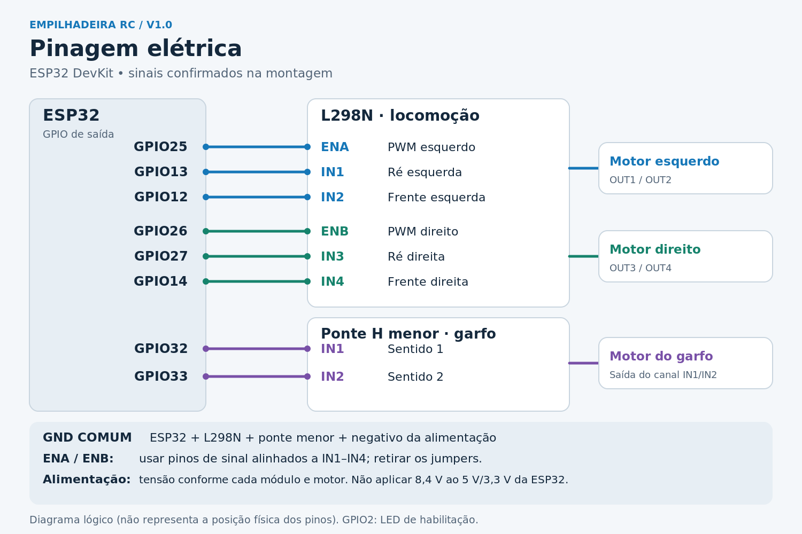
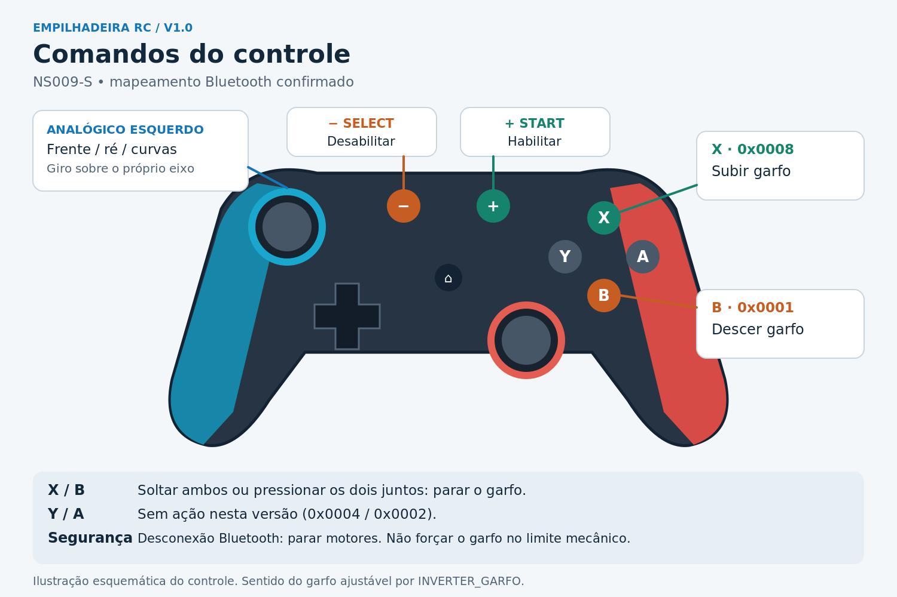

# Empilhadeira RC com ESP32

Projeto didático de mecatrônica: protótipo de empilhadeira com locomoção diferencial e garfo motorizado, comandado via Bluetooth por um controle NS009-S.

## Recursos
- Controle proporcional das duas rodas por PWM, com curvas e giro sobre o próprio eixo.
- Elevação e descida do garfo por botões de ação momentânea.
- Habilitação manual, parada por comando e por desconexão Bluetooth.

## Componentes
- ESP32 DevKit (ESP32 clássico, 30 pinos).
- Ponte H de locomoção L298N, com ENA e ENB controlados por PWM.
- Ponte H menor para o garfo (modelo exato não confirmado).
- Dois motores CC de locomoção e um motor CC para o garfo.
- Controle Bluetooth NS009-S; duas células 18650, suporte e fiação.
- Estrutura mecânica e mecanismo de elevação por fio dental.

## Modelo 3D e peças de reposição

A estrutura mecânica desta empilhadeira foi impressa em 3D a partir do modelo [3D Printed RC Forklift – Updated](https://www.printables.com/model/1189510-3d-printed-rc-forklift-updated), disponível no Printables. A página original é a referência para localizar os arquivos de impressão e produzir peças de reposição, caso necessário.

Os arquivos de impressão não estão incluídos nesta versão do repositório. A inclusão futura deverá respeitar a licença e os créditos do modelo original.

## Próxima versão (planejada)

- Construção de uma empilhadeira em escala maior.
- Inclusão de um motor adicional para controlar o movimento do conjunto do carro porta-garfos, ampliando os movimentos disponíveis.
- Atualização do firmware, da pinagem e do mapeamento do controle para o novo motor.
- Inclusão dos arquivos de impressão 3D, caso a licença original permita sua redistribuição.

Essas melhorias estão planejadas e ainda não fazem parte da montagem atual.

## Instalação
1. No Arduino IDE, remova/mova para fora da pasta de bibliotecas `Bluepad32_for_NINA-W10_boards`, caso instalada.
2. Em Arquivo > Preferências, adicione a URL do pacote ESP32 + Bluepad32:
   https://raw.githubusercontent.com/ricardoquesada/esp32-arduino-lib-builder/master/bluepad32_files/package_esp32_bluepad32_index.json
3. No Gerenciador de Placas, instale ESP32 + Bluepad32. Selecione ESP32 Dev Module **dentro desse pacote**, não no pacote ESP32 convencional.
4. Abra `firmware/empilhadeira/empilhadeira.ino`, selecione a porta e compile. O arquivo é autônomo; não precisa de `parametros.h`.
5. Abra o Monitor Serial a 115200 baud, conecte o controle e pressione + com os comandos em repouso.

Documentação da biblioteca: https://bluepad32.readthedocs.io/en/latest/plat_arduino/

## Ligações e comandos
- [Pinagem, alimentação e diagnóstico](docs/ligacoes.md)
- [Mapeamento do controle e ajustes](docs/controle.md)
- [Procedimento de teste](testes/README.md)
- [Registro fotográfico](imagens/README.md)

| Comando | Ação |
|---|---|
| Analógico esquerdo | Frente, ré, curvas e giro |
| X | Subir garfo (sentido configurável) |
| B | Descer garfo (sentido configurável) |
| + | Habilitar |
| − | Desabilitar |
| Soltar X/B | Parar garfo |

### Pinagem ilustrada

### Controle ilustrado

## Validação e limitações
A montagem foi testada pelo responsável: ambos os motores de locomoção e o motor do garfo giraram nos dois sentidos; o controle funcionou após ajustar as máscaras X e B. O sentido físico do garfo deve ser conferido após reinstalar o fio. O modelo exato da ponte menor, a tensão nominal dos motores, a topologia das baterias e a versão instalada do Bluepad32 não foram registrados. O firmware arquivado reproduz a versão final relatada, sem nova compilação neste ambiente. O timeout de dados é uma proteção de software cuja eficácia depende da semântica de `hasData()` na versão instalada; teste a perda de comunicação antes de operar. Não há fins de curso confirmados nem parada de emergência física; não utilizar para transporte de cargas reais.

## Licença
A definir pelo responsável pelo projeto. Nenhuma licença de reutilização é concedida automaticamente por este arquivo.
