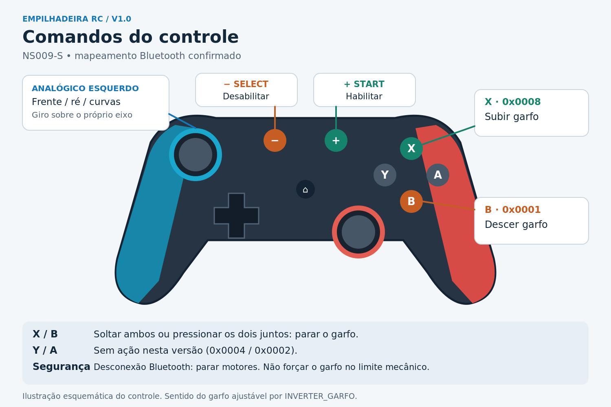

# Controle Bluetooth NS009-S

| Botão físico | Máscara `buttons()` observada | Ação |
|---|---|---|
| X | 0x0008 | Subir |
| B | 0x0001 | Descer |
| Y | 0x0004 | Sem ação |
| A | 0x0002 | Sem ação |

+ (START): `miscStart()` habilita com analógico e garfo em repouso. − (SELECT): `miscSelect()` desabilita. Analógico esquerdo: `axisY()` (invertido para frente positiva) e `axisX()` (direção). A mistura diferencial é esquerda = vertical + horizontal e direita = vertical − horizontal, com normalização de PWM.

## Configurações
| Constante | Padrão |
|---|---|
| VELOCIDADE_MAXIMA | 255 |
| VELOCIDADE_GARFO | 200 |
| ZONA_MORTA | 35 |
| INVERTER_GARFO | false |
| INVERTER_DIRECAO | false |
| TIMEOUT | 500 ms |

Pressionar X e B juntos interrompe o movimento do garfo. Soltar ambos também para o garfo. Não manter acionado no limite mecânico. Verificar sentido após reinstalar fio. Monitor Serial: 115200 baud, eixos e máscaras de botões.
