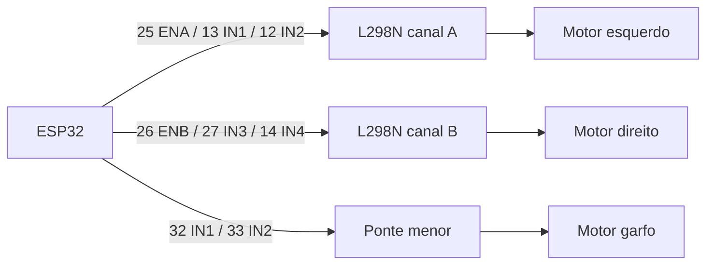
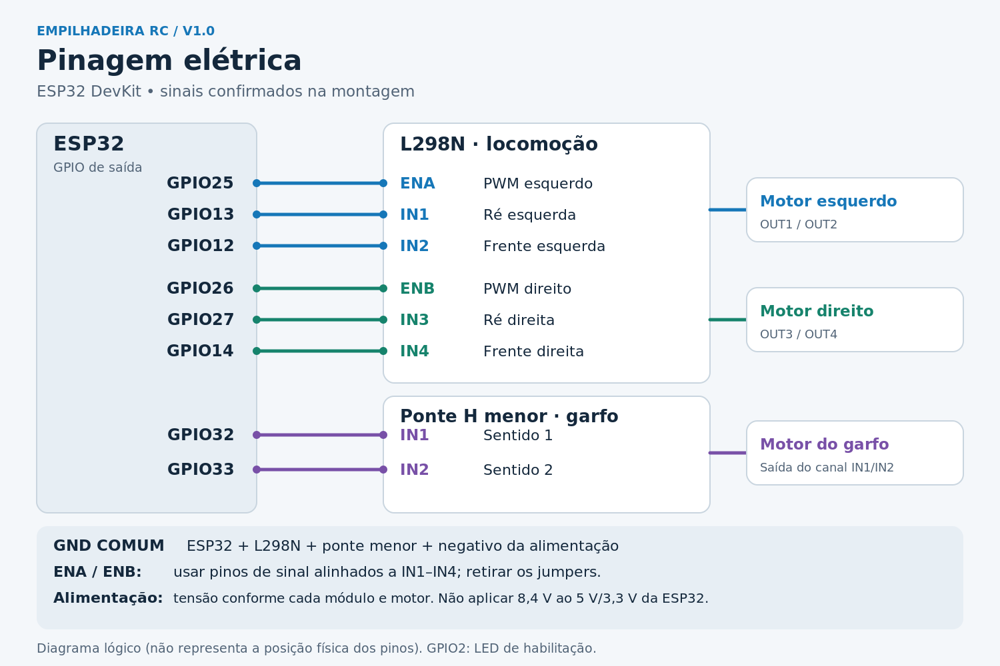

# Ligações elétricas

## Ponte H maior — locomoção

| ESP32 | L298N | Função confirmada |
|---|---|---|
| GPIO25 | ENA | PWM esquerdo |
| GPIO13 | IN1 | Ré esquerda |
| GPIO12 | IN2 | Frente esquerda |
| GPIO26 | ENB | PWM direito |
| GPIO27 | IN3 | Ré direita |
| GPIO14 | IN4 | Frente direita |

Motor A (OUT1/OUT2): roda esquerda. Motor B (OUT3/OUT4): roda direita. Mantenha os fios dos motores na polaridade validada nos testes.

ENA e ENB: retire os jumpers de habilitação e conecte os GPIOs aos pinos de sinal alinhados com IN1–IN4, conforme confirmado na montagem. Não conecte ao segundo pino (5 V na disposição típica do módulo).

## Ponte H menor — garfo

| ESP32 | Ponte menor | Função |
|---|---|---|
| GPIO32 | IN1 | Sentido 1 |
| GPIO33 | IN2 | Sentido 2 |

Ambos os sentidos foram testados com o fio de elevação desconectado. O sentido físico pode ser invertido por `INVERTER_GARFO` no firmware.

## Diagrama lógico

## Alimentação e cuidados
- GND comum entre ESP32, ponte maior e ponte menor.
- Alimentar cada ponte conforme sua especificação e tensão nominal dos motores. Não alimentar motores por GPIO.
- A ligação em série ou paralelo das células não foi confirmada. Duas células em série podem atingir 8,4 V; não aplique essa tensão ao pino 5 V/3,3 V da ESP32. Use alimentação regulada adequada e proteção compatível com as células.
- Desligue as baterias antes de modificar ligações, isole emendas e confira a polaridade.
- GPIO12 é pino de configuração de partida no ESP32 clássico; se houver falhas de boot, investigue o nível desse pino durante reset.
- GPIO2: LED de indicação de habilitação (conforme firmware).

## Problemas encontrados e resolvidos
| Sintoma | Causa observada | Solução |
|---|---|---|
| Erros PINS_COUNT e NINA_GPIO0 | Biblioteca Bluepad32 para NINA instalada | Remover e usar pacote ESP32 + Bluepad32 |
| Locomoção incorreta | Pinagem original não correspondia à montagem | Reescrever firmware segundo tabela |
| Motores não giravam com ENA/ENB no segundo pino | Conexão no terminal incorreto | Usar entrada de sinal alinhada a IN1–IN4 |
| Roda direita não avançava | Mau contato no jumper de sinal | Substituir jumper |
| Garfo não girava | Fios de alimentação da ponte menor soltos | Reconectar alimentação |
| X/B não acionavam garfo | Mapeamento diferente do esperado | Máscaras 0x0008 e 0x0001 |
