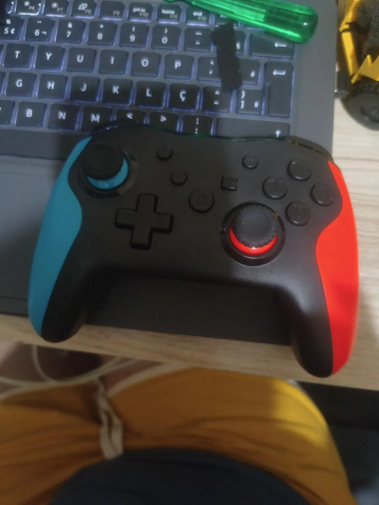
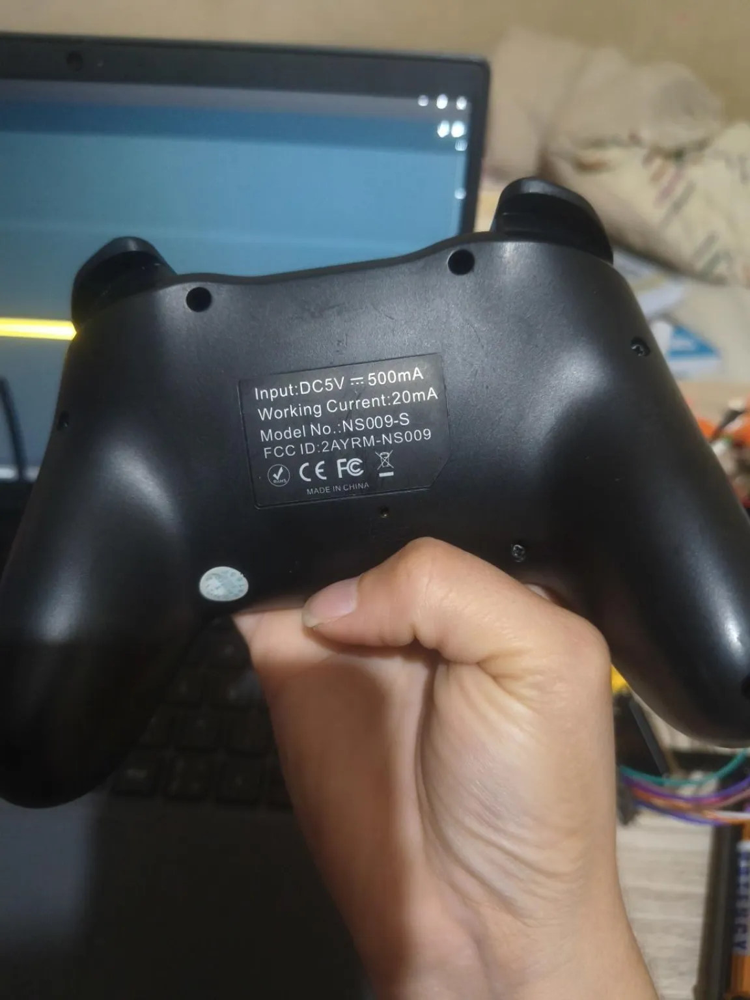
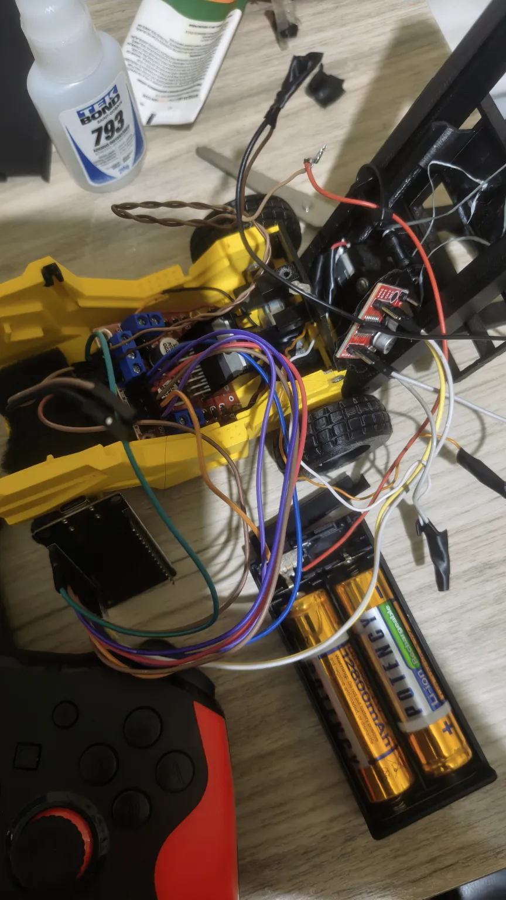
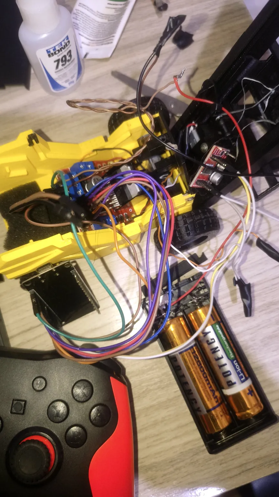
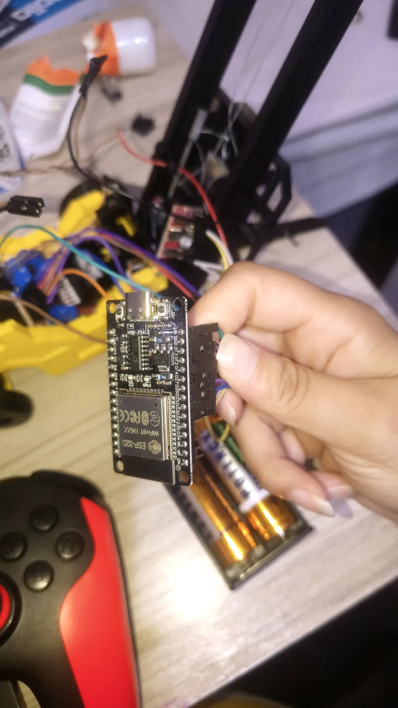
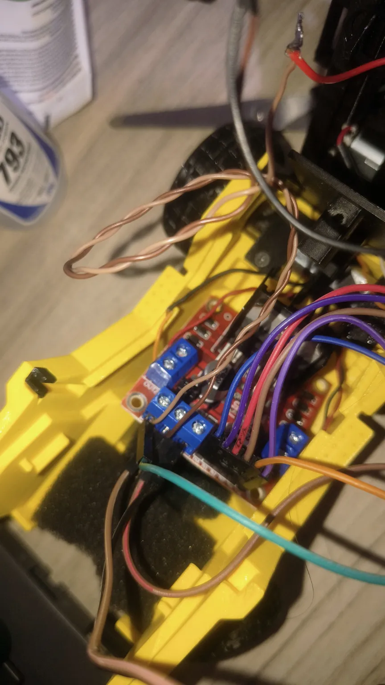
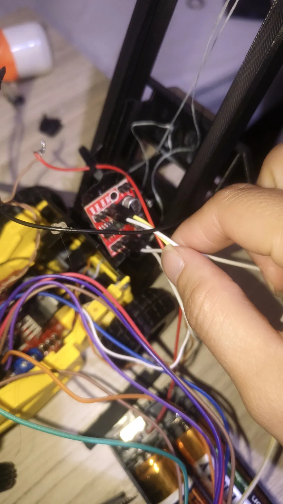
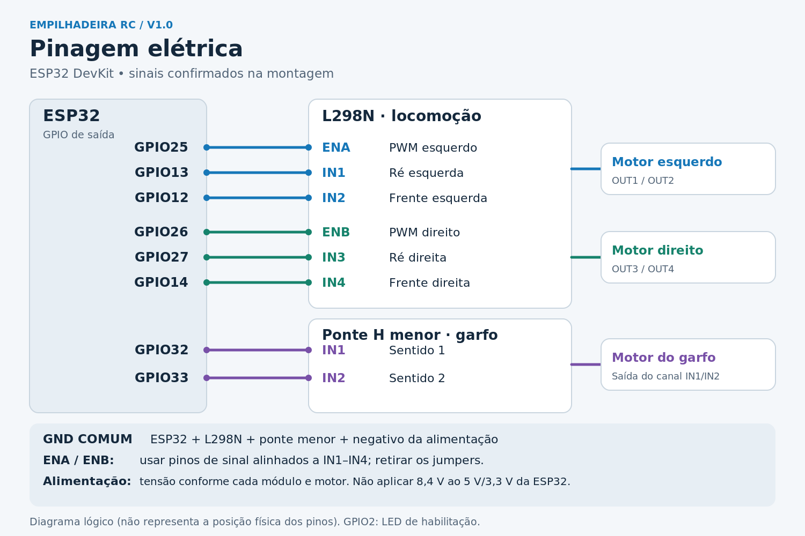
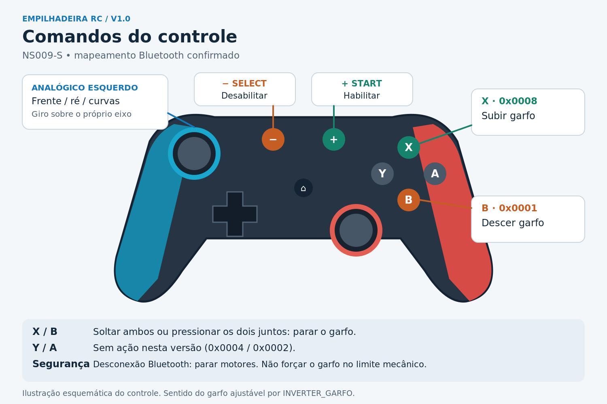

# Registro fotográfico

Fotos fornecidas durante a montagem e identificação do controle. Algumas mostram a fiação antes das correções; a tabela em `docs/ligacoes.md` representa a ligação final informada.

## Ilustrações técnicas

